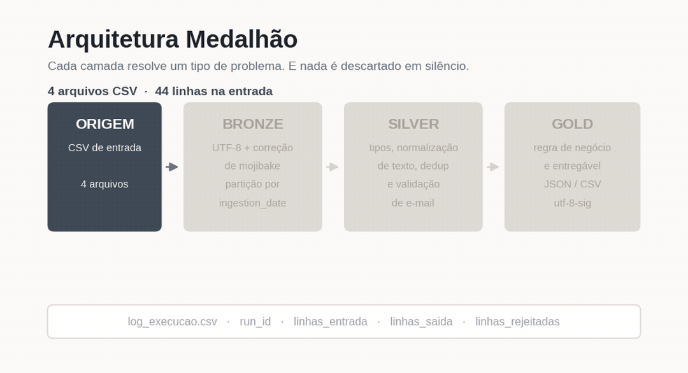
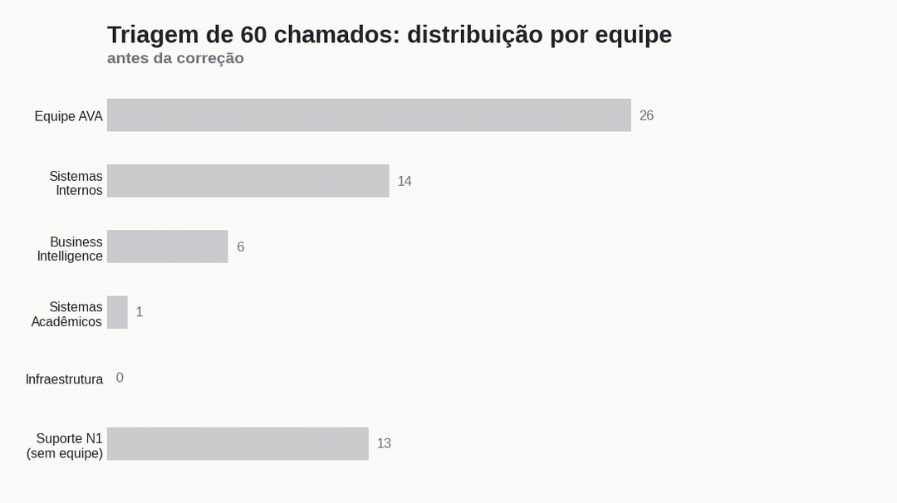

# AcadOps — Pipeline Medalhão para Automação de Processos Acadêmicos

Solução de engenharia de dados em Python que automatiza três processos operacionais de uma instituição de ensino superior, aplicando **Arquitetura Medalhão** (Bronze / Silver / Gold) com tratamento de qualidade, quarentena de registros inválidos e log auditável de execução.

> Os dados em `source_data/` são **sintéticos**, gerados apenas para demonstração. Nenhuma informação real de aluno, professor ou instituição está neste repositório.



---

## Os três fluxos

| Pipeline | Entrada | Regra de negócio | Entregável |
|---|---|---|---|
| **Moodle** | `pedidos_provas.csv` | Padroniza cabeçalho e converte tempo especial de aluno em estrutura aninhada | `data/gold/acoes_provas.json` |
| **SharePoint** | `pendencias_sharepoint.csv` + `mapa_sites_sharepoint.csv` | Resolve o site de destino por curso e define a ação por status | `data/gold/publicacao_documentos.csv` |
| **Chamados** | `chamados_suporte.csv` | Classifica o chamado na equipe responsável por vocabulário controlado | `data/gold/triagem_chamados.csv` |

Cada pipeline é independente: a falha de um não interrompe os outros.

---

## Arquitetura

```
source_data/  →  BRONZE  →  SILVER  →  GOLD  →  entregável
                    │          │
                    │          └─→ data/rejected/   (quarentena)
                    └─→ ingestion_date=YYYY-MM-DD    (partição)
```

**Bronze — dado bruto, rastreável.** Ingere o CSV de origem em partições por `ingestion_date`, padroniza tudo para UTF-8 e corrige *mojibake*. Nenhuma regra de negócio.

**Silver — dado confiável.** Valida tipos, normaliza texto (minúsculas, sem acento, sem pontuação), corrige variações de nome de sistema, deduplica por chave de negócio e valida e-mail. Registro que não passa não é descartado em silêncio: vai para `data/rejected/` com o motivo.

**Gold — dado de negócio.** Aplica as regras finais e materializa o entregável. CSVs são gravados em `utf-8-sig` para abrir corretamente no Excel; o JSON usa `ensure_ascii=False`.

---

## Decisões técnicas

**Encoding em duas frentes.** O fallback `utf-8 → latin-1` só resolve o arquivo que é latin-1 de verdade, porque nesse caso a leitura levanta exceção. O caso clássico do `Nutrição → Nutrição` é diferente: o arquivo já é UTF-8 válido, não há erro nenhum e o texto quebrado passa silencioso. A Bronze detecta a assinatura desse duplo encoding e desfaz a conversão.

**Vocabulário normalizado pela mesma função que o dado.** A Silver remove pontuação, então `e-mail` chega como `email`. Se a regra de triagem procurar `e-mail`, ela nunca casa. Por isso as palavras-chave passam pelo mesmo `clean_text()` aplicado ao texto do chamado.

**Comparação com fronteira de palavra.** Busca por substring casaria `ava` dentro de "avaliação" e `rede` dentro de "credenciais". A triagem usa `\b<termo>s?\b`, que mantém "provas" casando com "prova" sem casar no meio de outra palavra.

**Nada de descarte silencioso.** Todo `dropna` tem contrapartida: arquivo de rejeitados com `motivo_rejeicao` e contagem no log.

**URL montada, não concatenada.** O caminho de destino no SharePoint passa por `percent-encoding`, então `Documentos Acadêmicos` vira `Documentos%20Acad%C3%AAmicos` em vez de gerar endereço inválido.

**Reprocessamento previsto.** A partição é parâmetro, não `datetime.now()` fixo, o que permite backfill de uma data específica.

---

## Observabilidade

Cada execução grava uma linha em `logs/log_execucao.csv`:

| Campo | Para que serve |
|---|---|
| `run_id` | Correlaciona a execução com os arquivos gerados |
| `ingestion_date` | Qual partição foi processada |
| `status` / `duration_seconds` | Sucesso ou erro e tempo gasto |
| `linhas_entrada` / `linhas_saida` / `linhas_rejeitadas` | Conciliação de volume ponta a ponta |
| `details` | Caminho do entregável ou mensagem da exceção |

Se `linhas_entrada` e `linhas_saida` divergem, `linhas_rejeitadas` explica a diferença. É isso que separa um pipeline auditável de um script que "rodou sem erro".

---

## Como executar

```bash
pip install -r requirements.txt

# Executar todos os fluxos de uma vez (lote consolidado)
python pipelines/run_all.py

# Ou executar pipelines individualmente
python pipelines/run_pipeline_moodle.py
python pipelines/run_pipeline_sharepoint.py
python pipelines/run_pipeline_chamados.py

# Executar a suíte de testes automatizados
pytest -v
```

Reprocessar uma partição específica:

```bash
python pipelines/run_all.py --ingestion-date 2025-08-20
# ou individualmente:
python pipelines/run_pipeline_chamados.py --ingestion-date 2025-08-20
```

Os pipelines resolvem os caminhos a partir da raiz do projeto, então funcionam de qualquer diretório.

---

## Estrutura

```
acadops/
├── .github/
│   └── workflows/
│       └── ci.yml         # esteira de CI (Python 3.10/3.11/3.12 + Pytest + smoke test)
├── data/
│   ├── bronze/            # dado bruto particionado por ingestion_date
│   ├── silver/            # dado limpo em Parquet
│   ├── gold/              # ENTREGÁVEIS
│   └── rejected/          # quarentena particionada com motivo da rejeição
├── logs/
│   └── log_execucao.csv
├── pipelines/             # orquestradores (individuais e lote unificado)
│   ├── run_all.py
│   ├── run_pipeline_chamados.py
│   ├── run_pipeline_moodle.py
│   └── run_pipeline_sharepoint.py
├── source_data/           # CSVs de entrada
├── src/
│   ├── chamados/          # bronze.py / silver.py / gold.py
│   ├── moodle/
│   ├── sharepoint/
│   └── common/            # utilitários transversais (encoding, text, observability)
├── tests/                 # suíte de testes unitários e de integração (pytest)
├── requirements.txt
└── README.md
```

---

## O que o tratamento revelou nos dados

Números da execução atual, extraídos das camadas Gold:

- **6 chamados** de e-mail institucional eram roteados para o suporte genérico por incompatibilidade entre o vocabulário da regra e o texto já normalizado.
- **5 chamados** do Moodle vazavam da triagem porque uma correção de digitação (`moodl → moodle`) transformava a palavra correta em `moodlee`.
- **8 documentos** com status `Revisar` eram marcados como `Publicado` junto com os aprovados.
- **19 URLs** de destino saíam com espaço e acento sem codificação.
- **3 chamados** são reentradas do mesmo pedido por canais diferentes (Teams, e-mail, formulário), hoje sinalizados com `possivel_duplicata` e `id_referencia`.

Resultado: **0 chamados sem equipe definida** contra 13 antes do ajuste.



---

## Limitações conhecidas e próximos passos

- **A triagem é por vocabulário controlado, não por modelo.** É auditável e determinística, mas exige manutenção do dicionário — visível na coluna `regra_acionada`, que registra qual termo acionou cada classificação.
- **Orquestração e Agendamento.** A execução atual é via linha de comando local. O próximo passo natural é agendamento periódio (Airflow, Prefect ou cron de nuvem) usando o `run_id` como chave de correlação.
- **Conectores diretos de origem.** Atualmente os dados entram via arquivos CSV em `source_data/`. Uma evolução esperada é conexão direta com as APIs dos sistemas (Moodle Web Services, Microsoft Graph API para SharePoint e banco do sistema acadêmico).
